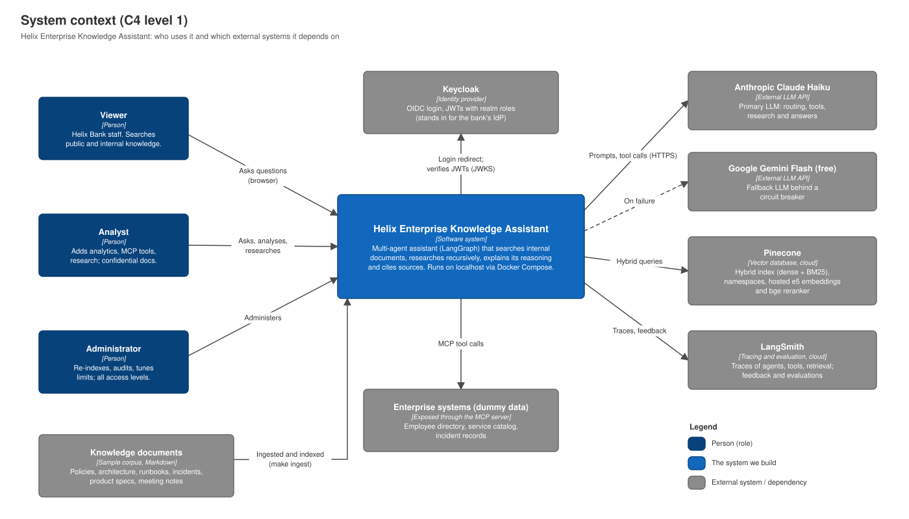

# Enterprise Knowledge Agent

[](https://github.com/madukawala/enterprise-knowledge-agent/actions/workflows/ci.yml)

A conversational assistant that helps staff find and understand information in their organisation's internal documents. It searches policies, architecture documents, runbooks, incident reports, product specifications and meeting notes. It explains how it reached each answer, cites the sources it used, and uses enterprise tools only when the user's role allows it.

The assistant is built for **Helix Commercial Bank**, a fictional bank. All documents, people, systems and incidents in this repository are made up.

## Project status

The project is built step by step, one feature branch at a time, following the plan in the [Roadmap](#roadmap) section. Done so far:

- the architecture and design;
- the project scaffold: settings, structured logging, error handling, a minimal API, the test harness and CI;
- the Docker Compose stack: the API, Postgres, Redis and Keycloak, with health checks, hardened containers, an internal network, an image scan in CI, and optional Prometheus and Grafana;
- the sample documents and ingestion: 70 Helix Bank documents in six collections, and `make ingest`, which chunks them and loads dense and BM25 vectors into one Pinecone namespace per collection;
- hybrid search: one weighted dense + BM25 score, a permission filter on every query, parallel queries across collections, re-ranking, and citations. Try it with `make search`, and measure it with `make eval-retrieval`;
- the LangGraph agents: an input guard, a supervisor that plans and routes, a retrieval agent, a response agent and a validator that checks every citation. They run on Claude Haiku with Gemini as the backup, contain failures so one broken part never stops an answer, and are traced in LangSmith. Ask them from the terminal with `make ask` or `make chat`;
- the streaming chat API: `POST /chat` streams the answer token by token, together with live events for the activity panel (each agent starting and finishing, the plan, the search, the checks, anything degraded). A client that disconnects stops the run, every run has a time limit, and conversations continue with follow-up questions. Watch it with `make stream`;
- the chat UI (Streamlit): the conversation on the left and the agent activity panel on the right, updated live as the answer streams in, with sources under each answer, a Stop button that cancels the agents, and follow-up questions. Open it at <http://localhost:8501> after `make up`, or run it with `make run-ui`;
- login and role checks: users sign in with Keycloak, and the API checks every access token itself (signature, issuer, audience, expiry). One deny-by-default role matrix decides what each role may do, for API routes, the agents' choice of tools and the document search. The UI shows the user's name and role and only the tools that role may use. Conversations belong to the signed-in user;
- rate limiting: each user may ask a few questions back to back and then a set number per minute (more for higher roles), and has a daily budget of language model tokens. The counts are in Redis, shared by every API worker; a question over a limit gets 429 with `Retry-After`, and the UI says when to try again and shows today's usage. Admins can change the limits while the API runs;
- guardrails: questions are scanned for prompt injection (including hidden forms such as look-alike letters and base64) and refused before any model runs; retrieved documents are cleaned and a document carrying planted instructions is left out; answers that repeat the internal instructions, show labels above the user's role or give investment advice are never shown; images and outside links are removed; personal data and secrets are masked in answers, the streamed preview, logs and traces. See [docs/security/PROMPT_INJECTION.md](docs/security/PROMPT_INJECTION.md);
- the Python sandbox: a separate container, with no network, a read-only file system and no keys, that runs the analysts' Python (`POST /tools/python`) and, later, the research agent's search plans. Code is checked before it runs, gets only safe built-ins and allow-listed standard modules, and runs in a fresh process with CPU, memory and time limits. See [sandbox/README.md](sandbox/README.md);
- recursive research for analysts and admins: a question such as "summarize payment-failure outages over the last year" makes the model write a Python search plan, which the sandbox checks and runs; the work is split into batches, each investigated by a sub-agent in parallel (splitting further when a batch holds too much, down to depth 3), and the findings are combined into one answer with citations. The activity panel shows the plan and every batch. See [docs/architecture/05-rlm-research.md](docs/architecture/05-rlm-research.md);
- memory: conversations are saved in Postgres and survive restarts; a long conversation is summarised so prompts stay small; each user's past questions are remembered (masked) and related ones are recalled into later answers; users see their earlier conversations in the sidebar and can see and clear what is remembered. See [docs/architecture/08-memory.md](docs/architecture/08-memory.md);
- resilience: each language model provider has a circuit breaker, so a provider that keeps failing or is rate limited is skipped for a while and then probed again; every dependency (Pinecone, the re-ranker, the sandbox, Redis, Keycloak, memory, LangSmith) has a reduced mode, and [docs/architecture/07-failure-handling.md](docs/architecture/07-failure-handling.md) lists each failure, what the user sees and the test that proves it;
- the MCP server: a separate container with Helix Bank's (fictional) employee directory, service catalog and incident records as three read-only MCP tools. For analysts and admins, a tools agent picks the calls, which are checked in code before they are sent, and the answer combines the live data with the documents. See [mcp_server/README.md](mcp_server/README.md).;
- human approval and feedback: deep research stops and asks the user first (LangGraph `interrupt`), then resumes from the checkpoint when they approve or reject it; every answer can be rated with thumbs up or down, which is saved, sent to the answer's LangSmith trace and listed for admins.;
- observability and evaluations: an audit log of every question for admins; a Grafana dashboard (`make up-observability`) for requests, latency, model calls and the circuit breakers, tokens, rate limits, guardrails, tools and feedback; an answer evaluation (`make eval-answers`) whose latest results are in [docs/evals/answers.md](docs/evals/answers.md); and smoke tests against the running stack, including the chat UI in a real browser (`make e2e`). [Getting started](#getting-started) brings up the stack that exists today, and [Development](#development) shows how to run the API and the UI, ask the agents from the terminal and run the checks.

## Contents

- [What the assistant does](#what-the-assistant-does)
- [Architecture](#architecture)
- [How a question is answered](#how-a-question-is-answered)
- [Roles and permissions](#roles-and-permissions)
- [Technology](#technology)
- [Project structure](#project-structure)
- [Getting started](#getting-started)
- [Development](#development)
- [Running the tests](#running-the-tests)
- [Documentation](#documentation)
- [Evidence for reviewers](#evidence-for-reviewers)
- [Roadmap](#roadmap)

## What the assistant does

- **Answers questions from internal documents.** It uses hybrid search: meaning-based (dense) search and keyword (BM25) search, combined into one score.
- **Shows its sources.** Every answer lists the document and section it came from, and the system checks that each citation is real.
- **Explains its reasoning.** Each answer ends with a short "How I got this answer" section: the steps taken, the sources used and any limits.
- **Does deeper research when needed.** For questions such as "Summarize payment-failure outages over the last year", a research agent plans the search, splits the work into batches, runs sub-agents in parallel and combines their findings.
- **Uses enterprise tools.** It can look up the employee directory, the service catalog and incident records through an MCP server, and run data analysis in a locked-down Python sandbox.
- **Remembers context.** Follow-up questions work within a conversation, and the assistant remembers useful facts about each user across conversations.
- **Shows what it is doing.** An activity panel next to the chat shows, as it happens, which agent is working, which tools are called, what the search found, what was saved to memory and whether the safety checks passed.
- **Stays safe.** Login through Keycloak, role-based access to tools and documents, rate limiting, prompt-injection defences, PII masking and checks on every answer.
- **Keeps working when parts fail.** If the main language model fails, a second provider takes over. If the search index, a tool or tracing is down, the assistant answers with what it has and says what was missing.

## Architecture

The system runs on one machine with Docker Compose. Only the language models, the vector database and tracing are cloud services. All of them are on free tiers except the main language model, Claude Haiku, which costs about a tenth of a US cent per question ([ADR-0017](docs/adr/0017-claude-haiku-primary-gemini-backup.md)).


The system context below shows who uses the assistant and which outside systems it depends on.



More diagrams, all in [docs/architecture](docs/architecture/README.md):

| Diagram | What it shows |
|---|---|
| [Agent graph](docs/architecture/03-agent-graph.drawio.svg) | The supervisor, the specialist agents and how work moves between them |
| [Agent graph, from the code](docs/architecture/03-agent-graph.generated.md) | The graph as built today, drawn by `make diagrams` |
| [Search pipeline](docs/architecture/04-search-pipeline.md) | How documents are indexed and how a question becomes cited results |
| [Recursive research](docs/architecture/05-rlm-research.md) | The six research steps, using the payment-failure outage example |
| [Layered security](docs/architecture/06-security-layers.drawio.svg) | Every check a request and an answer pass through |
| [Failure handling](docs/architecture/07-failure-handling.drawio.svg) | Language model failover and reduced modes for other services |
| [Memory](docs/architecture/08-memory.md) | Conversation memory, summaries and long-term memory per user |
| [Streaming events](docs/architecture/09-streaming-events.md) | The live events `POST /chat` sends to the activity panel, and the rules for clients |
| [Request lifecycle](docs/architecture/10-request-lifecycle.md) | One request from login to the final answer |

### Main components

| Component | Purpose |
|---|---|
| Streamlit UI | Chat window, list of past conversations, citations, feedback buttons and the agent activity panel |
| FastAPI backend | Async API. Streams answers and activity events to the UI with server-sent events |
| LangGraph agents | A supervisor that understands the question, plans the work and routes it to the retrieval, research and tool agents. A response agent writes the answer, a validator checks it, and a memory writer saves what is worth remembering |
| Pinecone | Vector database. One hybrid index with a namespace for each document collection |
| Keycloak | Login (OpenID Connect) and user roles |
| PostgreSQL | Conversation history, long-term memory, user feedback and the audit log |
| Redis | Rate limiting with a token bucket per user and role |
| MCP server | Dummy enterprise data: employee directory, service catalog, incident records |
| Python sandbox | Runs analysis code and research search plans in an isolated container |
| LangSmith | Traces every conversation, agent step, tool call and search |

## How a question is answered

1. The user logs in through Keycloak and asks a question in the chat.
2. The API checks the login token, applies the rate limit and validates the request.
3. The input guard scans the question for prompt-injection attempts.
4. The supervisor works out what the user wants, makes a short plan and sends the work to the right agents:
   - the **retrieval agent** searches the documents the user is allowed to read;
   - the **research agent** handles large questions by splitting them into smaller ones;
   - the **tool agent** calls MCP tools or the Python sandbox, after checking the user's role.
5. Risky or expensive steps pause for human approval.
6. The response agent writes the answer with citations, in the bank's professional tone.
7. The validator checks the citations, masks personal data and checks the tone. If the answer fails, it is rewritten once.
8. The answer streams to the chat while the activity panel shows each step. The memory writer saves useful facts for later.

## Roles and permissions

There are three roles, one per Keycloak realm role. Permissions are checked in code before every route, tool call and search, so the assistant cannot be talked into skipping them. The role comes only from the signed-in user's token, never from the request or the conversation.

| Tool or action | Viewer | Analyst | Administrator |
|---|---|---|---|
| Chat and knowledge search | Yes | Yes | Yes |
| Python analysis tool | No | Yes | Yes |
| MCP tools (employee directory, service catalog, incident records) | No | Yes | Yes |
| Recursive research | No | Yes | Yes |
| Admin tools (re-index documents, view the audit log, change rate limits, view all feedback, clean up old memory) | No | No | Yes |
| Document access levels | public, internal | public, internal, confidential | all levels, including restricted |

The table lives in one place in code, [security/policies.py](security/policies.py), and is explained in [security/README.md](security/README.md). Anything not listed there is refused. If a user's role cannot use what a question needs (for example a viewer asking for deep research), the assistant answers with a normal document search and says why.

## Technology

| Area | Tools |
|---|---|
| Language | Python 3.12, managed with `uv` |
| Frontend | Streamlit |
| Backend | FastAPI (async), Pydantic, structlog |
| Agents | LangGraph |
| Language models | Anthropic Claude Haiku (main, set up for low cost), Google Gemini Flash on its free tier (backup) |
| Search | Pinecone hybrid index, `multilingual-e5-large` embeddings, BM25, `bge-reranker-v2-m3` re-ranking |
| Identity | Keycloak |
| Storage | PostgreSQL, Redis |
| Tools | FastMCP, isolated Python sandbox |
| Safety | Prompt-injection rules, personal data masking and answer checks in code (ADR-0016) |
| Observability | LangSmith, Prometheus, Grafana (optional) |
| Testing | pytest, Ragas, Playwright, Locust |
| Quality and security checks | ruff, mypy, pre-commit, bandit, pip-audit, gitleaks, Trivy, GitHub Actions |
| Runtime | Docker Compose |

The reasons for each choice are recorded in [docs/adr](docs/adr/README.md).

## Project structure

```text
enterprise-knowledge-agent/
  api/            FastAPI app: routes, middleware, error handling, SSE streaming
  core/           Shared settings, structured logging and error types
  agents/         LangGraph graph, supervisor and specialist agents, shared state, prompts
  rag/            Search: chunk schema, BM25, embeddings, Pinecone index, filters, hybrid retrieval
  security/       Role matrix, authentication, guardrails, rate limiting
  ingestion/      Document parsing, chunking and indexing into Pinecone
  mcp_server/     MCP server with fictional enterprise data (directory, services, incidents)
  sandbox/        Python sandbox service, built into its own image from this folder alone
  ui/             Streamlit app and agent activity panel
  data/           Sample Helix Bank documents (data/sample_docs) and ingestion output (data/index, not committed)
  evals/          Evaluation question sets and runners (retrieval hit rate and MRR, answer quality)
  tests/          Unit, integration, graph, security, resilience and end-to-end tests
  docs/           Architecture diagrams, decision records, assumptions, threat model, testing
  infra/          Config for the Docker services: Keycloak realm, Postgres init, Prometheus, Grafana
  .github/        CI workflow
  Dockerfile      Images for the API, the UI and the MCP server (the sandbox has its own)
  compose.yaml    The full local stack; compose.dev.yaml adds live code reload
```

The `api/`, `agents/`, `ui/`, `security/`, `sandbox/`, `mcp_server/`, `rag/`, `ingestion/`, `data/` and `evals/` folders each have a README explaining how they work. Prompts are Markdown files in `agents/prompts/`, kept out of the code.

The code is one Python project with one `pyproject.toml` and one lock file, with two deliberate boundaries:

- The sandbox has its own small dependency file (`sandbox/requirements.txt`), so its image contains only Python's standard library, with no project code and no secrets. The image is built from the `sandbox/` folder alone, and import-linter checks that the sandbox and the app never import each other.
- The UI never imports backend code. It talks to the API only over HTTP and server-sent events. CI enforces this with [import-linter](https://import-linter.readthedocs.io/) (the contracts are in `pyproject.toml`), and the UI's image is built from its own dependency group (Streamlit and httpx), so it does not contain the backend at all. More contracts keep `core/` at the bottom layer, keep `rag/` and `security/` from importing the agents above them, keep `ingestion/` (an offline job) and `evals/` (run by hand) out of the running services, and keep the MCP server independent of the agents and the API.

## Getting started

### What you need

- Docker Desktop, with at least 6–8 GB of memory assigned to it
- Git and `make`
- Python 3.12 and [uv](https://docs.astral.sh/uv/), only if you want to run tests or tools outside Docker
- API keys for:
  - Anthropic (Claude, the main model). This is the only paid key: add a few US dollars of credit, which is enough for many hundreds of questions
  - Google AI Studio (Gemini, the backup model; free)
  - Pinecone (free)
  - LangSmith (free and optional; without it the app works but sends no traces)

  One model key is enough to run the agents. With both, an outage at one company does not stop the assistant.

### Setup

1. Clone the repository:

   ```bash
   git clone <repository-url>
   cd enterprise-knowledge-agent
   ```

2. Create your settings file and add your API keys:

   ```bash
   cp .env.example .env
   ```

   Open `.env` and fill in the keys. Every setting is explained in `.env.example`. Never commit `.env`.

   For the Docker stack, also replace every `change-me` password. Use letters, digits, `-` and `_` only, because the passwords go into connection URLs.

3. Start the full stack:

   ```bash
   make up
   ```

   This builds the API and UI images, starts every service and waits until all of them are healthy. The API container gets the model, Pinecone and LangSmith settings from `.env`; any of them may be empty, and the UI then shows what is missing (no model: the assistant is unavailable; no Pinecone: document search is unavailable). The first start downloads several images and takes a few minutes. `make ps` shows each service and its health, and <http://localhost:8000/readyz> should report `"status": "ready"`.

4. Load the sample documents into Pinecone. This needs `PINECONE_API_KEY` in `.env` (a free Starter key is enough) and runs on your machine, not in Docker:

   ```bash
   make ingest-check    # optional: check the documents first, no key needed
   make ingest
   ```

   The first run creates the `helix-knowledge` index (hybrid, `dotproduct`, 1024 dimensions). You can run it again at any time: it overwrites the same records, removes records of deleted documents, and never creates duplicates. See [ingestion/README.md](ingestion/README.md).

   Then try a search. Each role sees only the documents it may read:

   ```bash
   make search Q="why do card payments fail?" ROLE=analyst
   ```

   With `ANTHROPIC_API_KEY` and `CLAUDE_MODEL` (and ideally `GEMINI_API_KEY` and `GEMINI_MODEL` as the backup) in `.env`, ask the agents. You get an answer with citations and a "How I got this answer" section:

   ```bash
   make ask Q="What should I do when the PayHub connection pool runs out?" ROLE=viewer
   make chat ROLE=analyst    # a conversation; follow-up questions work
   ```

   To see each run in LangSmith, also set `LANGSMITH_TRACING=true` and `LANGSMITH_API_KEY`. See [agents/README.md](agents/README.md).

5. Open the chat at <http://localhost:8501> and sign in as one of the test users below. Ask a question or click one of the example questions. The answer streams in on the left and the agent activity panel on the right shows each step. The sidebar shows your name, your role and the tools your role may use. Sign out and in as another user to compare what each role may read. The UI is described in [ui/README.md](ui/README.md).

   The search and the answers use the documents loaded in step 4 (`data/index/` is mounted read-only into the API container).

### Test users

The Keycloak realm file ([infra/keycloak/realm-helix.json](infra/keycloak/realm-helix.json)) creates one user per role. The passwords are for this local demo only. Keycloak locks an account for a short while after 5 wrong passwords.

| User | Role | Password |
|---|---|---|
| `vera.viewer` | Viewer | `viewer-demo-pass` |
| `adam.analyst` | Analyst | `analyst-demo-pass` |
| `ada.admin` | Administrator | `admin-demo-pass` |

### Service addresses

| Service | Address |
|---|---|
| Chat UI | <http://localhost:8501> |
| API | <http://localhost:8000> (health: `/healthz`, readiness: `/readyz`, metrics: `/metrics`, docs: `/docs`) |
| Keycloak | <http://localhost:8080> (admin console: `/admin`, user `admin` and the password from `.env`) |
| Prometheus (optional) | <http://localhost:9090>, started with `make up-observability` |
| Grafana (optional) | <http://localhost:3000>, user `admin` and the password from `.env` |

Every port is published on `127.0.0.1` only, so nothing is reachable from other machines on your network. Postgres and Redis have no published ports at all.

### Stopping

```bash
make down            # stop the services and keep the data
make down-volumes    # stop the services and delete all local data
```

### How the Docker stack is set up

| Topic | What is done |
|---|---|
| Networks | `frontend` holds the services you open in a browser. `backend` is internal: it has no internet access and no published ports. Postgres and Redis are only on `backend`. |
| Start order | Every service has a health check, and services wait until the ones they need are healthy. The API is healthy only when `/readyz` passes, which checks Postgres and Redis. |
| Health endpoints | `/healthz` only says the process is running. `/readyz` checks each service the API needs and returns 503 if a required one is down. It reports `ok`, `failed` or `timeout` per check and never the error text, which goes to the log. |
| Hardened containers | The API and the UI run as an unprivileged user (UID 10001) with a read-only file system, all Linux capabilities dropped and `no-new-privileges`. Each service has a memory limit. |
| Small images | The images are built in stages. The final API stage holds only the installed packages, not the source or build tools. The UI image holds only Streamlit, httpx and the `ui/` folder: no backend code. Base images use exact version tags. |
| Secrets | Passwords come from `.env` and have no defaults, so the stack refuses to start without them. Each service receives only the variables it needs. Keycloak has its own database user and cannot read the application's tables. |
| Image scan | CI builds the API and UI images and scans them with Trivy. It fails on high or critical vulnerabilities that have a fix, and on risky Dockerfile settings. Run the same scan locally with `make scan-image`. |
| Monitoring (optional) | `make up-observability` adds Prometheus, which reads `/metrics` from the API, and Grafana with the "Helix Knowledge Assistant" dashboard already loaded: requests and latency, answer time, model calls by provider, the circuit breakers, tokens, rate limits, guardrail blocks, tools, searches and feedback. |

### Demo: model order and failover

Two models are set up: Claude answers first and Gemini takes over when Claude fails. The order is the `LLM_PROVIDERS` setting in `.env`, so it can be changed without touching code. Start the stack with `make up-observability` to see the Grafana panels too. These steps show the order and the backup at work:

1. **Normal run.** Ask a question. In the agent activity panel, the table under "Response" shows `anthropic / claude-haiku-5-5` for every call. `make logs` shows one `llm_call` line per call, with the provider, the model, the tokens (including those read from the prompt cache) and the time.
2. **Swap the order.** Set `LLM_PROVIDERS=gemini,anthropic` in `.env` and restart the API with `docker compose up -d --wait api` (a plain `docker compose restart` does not read `.env` again). Ask again: the table now shows `gemini / gemini-3.6-flash`.
3. **The first model fails.** Set the key of the model listed first (for example `GEMINI_API_KEY`) to a wrong value and restart the API the same way. Ask again. The activity panel says "The main model did not answer, so anthropic / claude-haiku-5-5 was used", the table marks those calls "backup model: yes", and the logs show `llm_call_failed` followed by `llm_call` with `"fallback": true`. In Grafana, "Fallbacks to the backup model" goes up, and after five failures within a minute "Circuit breaker per provider" shows the failing model as open (2). From then on the failing model is skipped, so answers come straight from the backup without waiting.
4. **Put it back.** Restore the key, set `LLM_PROVIDERS=anthropic,gemini` and restart the API.

Every failure the system plans for, and how to show the others live, is in [07-failure-handling.md](docs/architecture/07-failure-handling.md).

## Development

You need Python 3.12 and [uv](https://docs.astral.sh/uv/). uv downloads Python 3.12 itself if it is missing, so the default `python3` on your machine does not matter.

```bash
make install     # install all dependencies and the pre-commit hooks
make run-api     # start only the API on http://localhost:8000 with auto-reload
```

Open <http://localhost:8000/healthz> to check it is running, or <http://localhost:8000/docs> for the interactive API docs. Every other endpoint needs a login token from Keycloak, so start Keycloak too (`docker compose up -d keycloak`, or the whole stack with `make up`). Then, with a model key in `.env`, ask a question as one of the test users and watch the events stream back:

```bash
make stream Q="The PayHub database connection pool is exhausted. What should I do?" ROLE=analyst
curl -H "Authorization: Bearer $(make -s token ROLE=admin)" http://localhost:8000/me
```

Then start the chat UI in a second terminal and open <http://localhost:8501>:

```bash
make run-ui      # reloads when you edit a file in ui/
```

`make token ROLE=...` signs a test user in and prints a 5-minute access token. The endpoints and how tokens are checked are described in [api/README.md](api/README.md). Settings are read from environment variables or a `.env` file; copy `.env.example` to get started. `LOG_FORMAT=console` gives readable logs while you work. When `POSTGRES_URL` and `REDIS_URL` are empty, `/readyz` skips those checks, so the API runs fine on its own.

To work inside the Docker stack instead, run `make up-dev`. The API and UI containers then run the code from your machine and reload when you save a file. A rebuild is only needed after you add a dependency.

Run `make` on its own to list every task. The main ones:

| Command | What it does |
|---|---|
| `make lint` / `make format` | Check or fix code style (ruff) |
| `make typecheck` | Strict type checks (mypy) |
| `make imports` | Check that the UI does not import backend code (import-linter) |
| `make test` | Run the tests with the 80% coverage gate |
| `make audit` | Security lint (bandit) and known vulnerabilities in dependencies (pip-audit) |
| `make check` | Everything above, the same checks CI runs |
| `make up` / `make up-dev` / `make down` | Start or stop the Docker stack |
| `make ps` / `make logs` | Service health and logs |
| `make compose-check` | Check the Compose files without starting anything |
| `make run-api` / `make run-ui` | Run the API or the chat UI on your machine, without Docker |
| `make scan-image` | Scan the API and UI images with Trivy |
| `make ingest-check` / `make ingest` | Check the sample documents, or load them into Pinecone |
| `make search Q="..." ROLE=analyst` | Search the index as a role and print the ranked, cited chunks |
| `make eval-retrieval` | Hit rate and MRR for several alpha values, saved to `docs/evals/retrieval.md` |
| `make ask Q="..." ROLE=analyst` / `make chat` | Ask the agents one question, or have a conversation, in the terminal |
| `make eval-answers` | Ask the answer question set through the real agents and score it (`docs/evals/answers.md`) |
| `make e2e` / `make load` | Smoke tests (with a real browser) and an optional load test against the running stack |
| `make stream Q="..." ROLE=analyst` | Sign in as the test user for ROLE, ask the running API and print the streamed events, as the UI receives them |
| `make test-sandbox` | Escape tests inside the running sandbox container |
| `make token ROLE=admin` | Print an access token for a test user, for calling the API by hand |
| `make rate-limits` | Show the rate limits in force (as the test admin) |
| `make diagrams` | Redraw the agent graph from the code (`docs/architecture/03-agent-graph.generated.md`) |

The pre-commit hooks run ruff, mypy, the import check, gitleaks and a few file checks before each commit. CI runs the same checks on every pull request, plus a gitleaks scan of the full history, a check of the Compose files and a Trivy scan of the API and UI images.

Dependencies are managed with uv. Add one with `uv add <package>` (or `uv add --dev <package>` for a tool), and commit the updated `uv.lock` together with `pyproject.toml`.

### Code conventions

- Settings come from `core.config.get_settings()`, never straight from `os.environ`.
- Log with `core.logging.get_logger(__name__)` and short `snake_case` event names, adding details as fields: `logger.info("document_indexed", doc_id=..., chunks=12)`. Each line already carries the request ID. Fields named like secrets (`api_key`, `password`, `authorization`, ...) are replaced with `[REDACTED]`.
- Security events (denied access, blocked prompts, rate-limit hits) go to the `security` logger.
- Errors the user should see are raised as a subclass of `core.errors.AppError`. The API turns them into one JSON shape: `{"error": {"code", "message", "request_id"}}`. Any other exception becomes a generic 500 response, and its details go only to the log.

## Running the tests

The tests do not call the real language models: a scripted fake model plays them, so the tests are free and give the same result every run.

```bash
make test            # unit, integration, graph, security and resilience tests, with coverage
make test-unit       # fast unit tests only
make test-security   # security tests only
make test-live       # tests that call the real cloud services (uses your API keys)
make test-pinecone-local  # search tests against Pinecone's emulator in Docker (no account needed)
make test-keycloak   # login tests against the real Keycloak in Docker
```

The tests do not need Keycloak either: they sign their own tokens with a key pair made for the test run, and the test apps trust that key instead of Keycloak's. `make test-keycloak` checks the same code against the real realm.

The chat UI is tested without a browser: Streamlit's `AppTest` runs the page in the test process against replies recorded from the real API. `make eval-answers` (answer quality, calls the real models, a few US cents a run), `make e2e` (smoke tests against the running stack, including the chat UI in Chromium through Playwright; run `uv run playwright install chromium` once) and `make load` (an optional Locust load test) need the stack running.

The full testing strategy is in [docs/TESTING.md](docs/TESTING.md).

## Documentation

| Document | Contents |
|---|---|
| [docs/architecture](docs/architecture/README.md) | All architecture diagrams |
| [docs/adr](docs/adr/README.md) | Architecture decision records: what was decided and why |
| [docs/ASSUMPTIONS.md](docs/ASSUMPTIONS.md) | Assumptions and trade-offs |
| [docs/security/THREAT_MODEL.md](docs/security/THREAT_MODEL.md) | Threats, the controls against them and the tests that prove them |
| [docs/security/PROMPT_INJECTION.md](docs/security/PROMPT_INJECTION.md) | How prompt injection is defended against, layer by layer |
| [docs/TESTING.md](docs/TESTING.md) | Testing strategy, test layers and CI checks |
| [docs/evals](docs/evals/README.md) | Evaluation results, starting with retrieval |

## Evidence for reviewers

### LangSmith traces

These are public, read-only links to traces from the running stack, taken on 2026-11-21 (the document question on 2026-11-22). They open without a LangSmith account. Each trace shows the full tree of agent steps, the searches with their filters and results, the model calls with tokens and timing, and any tool calls.

| Trace | Role | What to look at |
|---|---|---|
| [Document question](https://smith.langchain.com/public/1ce44665-6872-4ae3-8cf3-cd1e3ee25da0/r) | Viewer | Agent transitions; the `pinecone_search` step under `retrieval`, with the query, the Pinecone filter including the viewer's `access_level` rule, and the chunks it returned; and the citations checked by the validator |
| [Research paused for approval](https://smith.langchain.com/public/5844ef8b-fa90-40c3-a4a7-4ecedfc70411/r) | Analyst | The assignment's outage question stopping at the LangGraph `interrupt` before any research runs |
| [Research resumed after approval](https://smith.langchain.com/public/a6d1f38f-3d34-4889-9012-d47c91270205/r) | Analyst | The same run resumed from the checkpoint: the collections explored, the Python search plan run in the sandbox, the batch sub-agents and the combined answer with recurring root causes |
| [Blocked prompt injection](https://smith.langchain.com/public/45631916-6cbf-438c-8dfb-d09992f9bbdf/r) | Viewer | Refused by the input guard, with no model call and no search |
| [MCP tools](https://smith.langchain.com/public/465a4f1d-ef8e-4016-aec0-11ad43b867e7/r) | Analyst | The tools agent calling the service catalog and the employee directory over MCP. Staff e-mail addresses in the tool results show as `[EMAIL]` |
| [Backup model taking over](https://smith.langchain.com/public/8d8b31d7-eec0-481d-8f4e-924d0b27a591/r) | Analyst | Asked with a wrong Claude key on purpose. Every Claude call is refused and Gemini takes over the search plan (`fallback=True`). Gemini then timed out on the later steps, so the run ends in the reduced mode: the most relevant sources, with a note that no model could write the answer |
| [Evaluation scores](https://smith.langchain.com/public/c118fe26-1bbc-4251-83f5-f8564d8bbdcb/r) | Viewer | A question from `make eval-answers --langsmith`; its scores (`eval_kind_correct`, `eval_citation_recall`, `eval_mentions`, `eval_grounded`) are attached to the trace as feedback |

How to read them:

- Each trace's metadata carries the role, the request ID, the thread ID and the user as a pseudonym, never the username.
- Personal data is masked before a trace leaves the machine: e-mail addresses, phone numbers, card numbers and keys show as `[EMAIL]`, `[PHONE]` and so on, in every step. Names are not masked, which is why tracing is used with the fictional sample data only.
- Scores and user feedback are not visible on a public link. The latest evaluation run, with every score, is written up in [docs/evals/answers.md](docs/evals/answers.md) (Run 4).

To see your own traces, set `LANGSMITH_TRACING=true` and `LANGSMITH_API_KEY` in `.env`. Every question then appears in the LangSmith project `helix-knowledge-agent`.

### Pinecone

The index can be rebuilt with a free Pinecone key: add it to `.env` and run `make ingest`. This creates the index `helix-knowledge` with one namespace per collection (`policies`, `architecture`, `runbooks`, `incidents`, `product-specs`, `meeting-notes`). Each record holds dense and sparse values and its metadata (`doc_id`, `title`, `section`, `department`, `document_type`, `access_level`, `created_date`).

To see the access filter at work, run the same search as two roles:

```bash
make search Q="salary-day payment failures" ROLE=viewer
make search Q="salary-day payment failures" ROLE=analyst
```

The viewer's results are all `internal`. The analyst's top results are the `confidential` incident report INC-2026-003 and its post-incident review. Each row shows the hybrid score, the re-rank score, the access level, and the document and section it came from. Search quality is measured in [docs/evals/retrieval.md](docs/evals/retrieval.md).

## Roadmap

Each feature is built on its own branch, merged into `develop`, and `develop` is merged into `main` when everything is complete. All 19 are built; each branch's tests are listed in [docs/TESTING.md](docs/TESTING.md#test-focus-per-branch), and each design change made while building is recorded in its decision record under "Changes during implementation".

| # | Branch | What it adds |
|---|---|---|
| 1 | `feature/architecture-design` | Diagrams, decision records, assumptions, threat model, testing strategy |
| 2 | `feature/project-scaffold` | Project layout, settings, logging, test setup, CI |
| 3 | `feature/docker-infra` | Docker Compose stack, health checks, hardened images |
| 4 | `feature/sample-data-ingestion` | Helix Bank documents, chunking, indexing into Pinecone |
| 5 | `feature/hybrid-retrieval` | Hybrid search, permission filters, re-ranking, citations |
| 6 | `feature/langgraph-agents` | Supervisor and agents, LangSmith tracing |
| 7 | `feature/streaming-api` | Streaming chat endpoint and activity events |
| 8 | `feature/streamlit-ui` | Chat window and agent activity panel |
| 9 | `feature/auth-rbac` | Keycloak login and role checks |
| 10 | `feature/rate-limiting` | Token-bucket rate limiting and token budget |
| 11 | `feature/guardrails` | Prompt-injection defence, PII masking, answer checks |
| 12 | `feature/python-sandbox` | Python analysis tool and sandbox |
| 13 | `feature/rlm-research` | Recursive research agent |
| 14 | `feature/memory` | Conversation, summary and long-term memory |
| 15 | `feature/resilience` | Language model failover, circuit breaker, reduced modes |
| 16 | `feature/mcp-server` | MCP server with dummy enterprise data |
| 17 | `feature/hitl-feedback` | Human approval step and feedback loop |
| 18 | `feature/observability-evals` | Metrics, dashboards, evaluations, end-to-end tests |
| 19 | `docs/final-documentation` | Final documentation, trace links and demo material |

## License

This project is released under the terms in [LICENSE](LICENSE).
