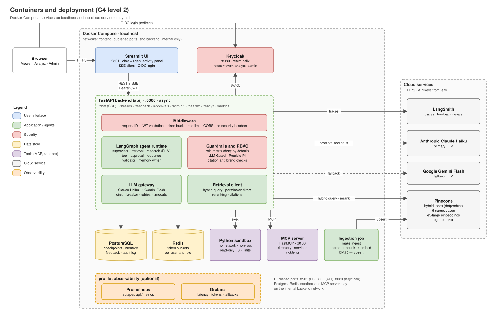

# Enterprise Knowledge Agent

[](https://github.com/madukawala/enterprise-knowledge-agent/actions/workflows/ci.yml)

A conversational assistant that helps staff find and understand information in their organisation's internal documents. It searches policies, architecture documents, runbooks, incident reports, product specifications and meeting notes. It explains how it reached each answer, cites the sources it used, and uses enterprise tools only when the user's role allows it.

The assistant is built for **Helix Commercial Bank**, a fictional bank. All documents, people, systems and incidents in this repository are made up.

## Project status

The project is built step by step, one feature branch at a time, following the plan in the [Roadmap](#roadmap) section. Done so far:

- the architecture and design;
- the project scaffold: settings, structured logging, error handling, a minimal API, the test harness and CI;
- the Docker Compose stack: the API, Postgres, Redis and Keycloak, with health checks, hardened containers, an internal network, an image scan in CI, and optional Prometheus and Grafana;
- the sample documents and ingestion: 70 Helix Bank documents in six collections, and `make ingest`, which chunks them and loads dense and BM25 vectors into one Pinecone namespace per collection.

Search, the chat UI, the agents, the MCP server and the sandbox are added by the next branches. Until then, [Getting started](#getting-started) brings up the stack that exists today, and [Development](#development) shows how to run the API and the checks.

## Contents

- [What the assistant does](#what-the-assistant-does)
- [Architecture](#architecture)
- [How a question is answered](#how-a-question-is-answered)
- [Roles and permissions](#roles-and-permissions)
- [Technology](#technology)
- [Project structure](#project-structure)
- [Getting started](#getting-started)
- [Development](#development)
- [Running the tests](#running-the-tests)
- [Documentation](#documentation)
- [Roadmap](#roadmap)

## What the assistant does

- **Answers questions from internal documents.** It uses hybrid search: meaning-based (dense) search and keyword (BM25) search, combined into one score.
- **Shows its sources.** Every answer lists the document and section it came from, and the system checks that each citation is real.
- **Explains its reasoning.** Each answer ends with a short "How I got this answer" section: the steps taken, the sources used and any limits.
- **Does deeper research when needed.** For questions such as "Summarize payment-failure outages over the last year", a research agent plans the search, splits the work into batches, runs sub-agents in parallel and combines their findings.
- **Uses enterprise tools.** It can look up the employee directory, the service catalog and incident records through an MCP server, and run data analysis in a locked-down Python sandbox.
- **Remembers context.** Follow-up questions work within a conversation, and the assistant remembers useful facts about each user across conversations.
- **Shows what it is doing.** An activity panel next to the chat shows, as it happens, which agent is working, which tools are called, what the search found, what was saved to memory and whether the safety checks passed.
- **Stays safe.** Login through Keycloak, role-based access to tools and documents, rate limiting, prompt-injection defences, PII masking and checks on every answer.
- **Keeps working when parts fail.** If the main language model fails, a second provider takes over. If the search index, a tool or tracing is down, the assistant answers with what it has and says what was missing.

## Architecture

The system runs on one machine with Docker Compose. Only the language models, the vector database and tracing are cloud services, all on free tiers.



The system context below shows who uses the assistant and which outside systems it depends on.


More diagrams, all in [docs/architecture](docs/architecture/README.md):

| Diagram | What it shows |
|---|---|
| [Agent graph](docs/architecture/03-agent-graph.drawio.svg) | The supervisor, the specialist agents and how work moves between them |
| [Search pipeline](docs/architecture/04-search-pipeline.md) | How documents are indexed and how a question becomes cited results |
| [Recursive research](docs/architecture/05-rlm-research.md) | The six research steps, using the payment-failure outage example |
| [Layered security](docs/architecture/06-security-layers.drawio.svg) | Every check a request and an answer pass through |
| [Failure handling](docs/architecture/07-failure-handling.drawio.svg) | Language model failover and reduced modes for other services |
| [Memory](docs/architecture/08-memory.md) | Conversation memory, summaries and long-term memory per user |
| [Streaming events](docs/architecture/09-streaming-events.md) | The live events the activity panel receives |
| [Request lifecycle](docs/architecture/10-request-lifecycle.md) | One request from login to the final answer |

### Main components

| Component | Purpose |
|---|---|
| Streamlit UI | Chat window, list of past conversations, citations, feedback buttons and the agent activity panel |
| FastAPI backend | Async API. Streams answers and activity events to the UI with server-sent events |
| LangGraph agents | A supervisor that understands the question, plans the work and routes it to the retrieval, research and tool agents. A response agent writes the answer, a validator checks it, and a memory writer saves what is worth remembering |
| Pinecone | Vector database. One hybrid index with a namespace for each document collection |
| Keycloak | Login (OpenID Connect) and user roles |
| PostgreSQL | Conversation history, long-term memory, user feedback and the audit log |
| Redis | Rate limiting with a token bucket per user and role |
| MCP server | Dummy enterprise data: employee directory, service catalog, incident records |
| Python sandbox | Runs analysis code and research search plans in an isolated container |
| LangSmith | Traces every conversation, agent step, tool call and search |

## How a question is answered

1. The user logs in through Keycloak and asks a question in the chat.
2. The API checks the login token, applies the rate limit and validates the request.
3. The input guard scans the question for prompt-injection attempts.
4. The supervisor works out what the user wants, makes a short plan and sends the work to the right agents:
   - the **retrieval agent** searches the documents the user is allowed to read;
   - the **research agent** handles large questions by splitting them into smaller ones;
   - the **tool agent** calls MCP tools or the Python sandbox, after checking the user's role.
5. Risky or expensive steps pause for human approval.
6. The response agent writes the answer with citations, in the bank's professional tone.
7. The validator checks the citations, masks personal data and checks the tone. If the answer fails, it is rewritten once.
8. The answer streams to the chat while the activity panel shows each step. The memory writer saves useful facts for later.

## Roles and permissions

There are three roles. Permissions are checked in code before every route, tool call and search, so the assistant cannot be talked into skipping them.

| Tool or action | Viewer | Analyst | Administrator |
|---|---|---|---|
| Chat and knowledge search | Yes | Yes | Yes |
| Python analysis tool | No | Yes | Yes |
| MCP tools (employee directory, service catalog, incident records) | No | Yes | Yes |
| Recursive research | No | Yes | Yes |
| Admin tools (re-index documents, view the audit log, change rate limits, view all feedback) | No | No | Yes |
| Document access levels | public, internal | public, internal, confidential | all levels, including restricted |

## Technology

| Area | Tools |
|---|---|
| Language | Python 3.12, managed with `uv` |
| Frontend | Streamlit |
| Backend | FastAPI (async), Pydantic, structlog |
| Agents | LangGraph |
| Language models | Google Gemini Flash (main), Groq with Llama 3.3 70B (fallback) |
| Search | Pinecone hybrid index, `multilingual-e5-large` embeddings, BM25, `bge-reranker-v2-m3` re-ranking |
| Identity | Keycloak |
| Storage | PostgreSQL, Redis |
| Tools | FastMCP, isolated Python sandbox |
| Safety | LLM Guard, Microsoft Presidio, custom checks |
| Observability | LangSmith, Prometheus, Grafana (optional) |
| Testing | pytest, Ragas, Playwright, Locust |
| Quality and security checks | ruff, mypy, pre-commit, bandit, pip-audit, gitleaks, Trivy, GitHub Actions |
| Runtime | Docker Compose |

The reasons for each choice are recorded in [docs/adr](docs/adr/README.md).

## Project structure

```text
enterprise-knowledge-agent/
  api/            FastAPI app: routes, middleware, error handling, SSE streaming
  core/           Shared settings, structured logging and error types
  agents/         LangGraph graph, supervisor and specialist agents, shared state
  rag/            Search building blocks: chunk schema, BM25 encoder, embeddings, Pinecone index
  security/       Role matrix, authentication, guardrails, rate limiting
  ingestion/      Document parsing, chunking and indexing into Pinecone
  mcp_server/     MCP server with dummy enterprise data
  sandbox/        Python sandbox service
  ui/             Streamlit app and agent activity panel
  prompts/        Prompt templates, kept out of the code
  data/           Sample Helix Bank documents (data/sample_docs) and ingestion output (data/index, not committed)
  evals/          Evaluation datasets
  tests/          Unit, integration, graph, security, resilience and end-to-end tests
  docs/           Architecture diagrams, decision records, assumptions, threat model, testing
  infra/          Config for the Docker services: Keycloak realm, Postgres init, Prometheus, Grafana
  .github/        CI workflow
  Dockerfile      Image for the API (UI and MCP server targets are added later)
  compose.yaml    The full local stack; compose.dev.yaml adds live code reload
```

Folders are added as their features are built. So far `api/`, `core/`, `security/` (roles and access levels), `rag/`, `ingestion/`, `data/`, `ui/` (empty package), `infra/` and `tests/` exist. The `rag/`, `ingestion/` and `data/` folders each have a README explaining how they work.

The code is one Python project with one `pyproject.toml` and one lock file, with two deliberate boundaries:

- The sandbox has its own small dependency file (`sandbox/requirements.txt`), so its image contains only data-analysis libraries, with no project code and no secrets.
- The UI never imports backend code. It talks to the API only over HTTP and server-sent events. CI enforces this with [import-linter](https://import-linter.readthedocs.io/) (the contracts are in `pyproject.toml`). Two more contracts keep `core/` at the bottom layer, and keep `ingestion/` (an offline job) out of the running services.

## Getting started

### What you need

- Docker Desktop, with at least 6–8 GB of memory assigned to it
- Git and `make`
- Python 3.12 and [uv](https://docs.astral.sh/uv/), only if you want to run tests or tools outside Docker
- Free accounts and API keys for:
  - Google AI Studio (Gemini)
  - Groq
  - Pinecone
  - LangSmith (optional; without it the app works but sends no traces)

### Setup

1. Clone the repository:

   ```bash
   git clone <repository-url>
   cd enterprise-knowledge-agent
   ```

2. Create your settings file and add your API keys:

   ```bash
   cp .env.example .env
   ```

   Open `.env` and fill in the keys. Every setting is explained in `.env.example`. Never commit `.env`.

   For the Docker stack, also replace every `change-me` password. Use letters, digits, `-` and `_` only, because the passwords go into connection URLs.

3. Start the full stack:

   ```bash
   make up
   ```

   This builds the API image, starts every service and waits until all of them are healthy. The first start downloads several images and takes a few minutes. `make ps` shows each service and its health, and <http://localhost:8000/readyz> should report `"status": "ready"`.

4. Load the sample documents into Pinecone. This needs `PINECONE_API_KEY` in `.env` (a free Starter key is enough) and runs on your machine, not in Docker:

   ```bash
   make ingest-check    # optional: check the documents first, no key needed
   make ingest
   ```

   The first run creates the `helix-knowledge` index (hybrid, `dotproduct`, 1024 dimensions). You can run it again at any time: it overwrites the same records, removes records of deleted documents, and never creates duplicates. See [ingestion/README.md](ingestion/README.md).

5. Open the app at <http://localhost:8501> and log in with one of the test users below. Use a different user to try each role.

Step 5 works once the UI branch is merged.

### Test users

The Keycloak realm file ([infra/keycloak/realm-helix.json](infra/keycloak/realm-helix.json)) creates one user per role. The passwords are for this local demo only.

| User | Role | Password |
|---|---|---|
| `vera.viewer` | Viewer | `viewer-demo-pass` |
| `adam.analyst` | Analyst | `analyst-demo-pass` |
| `ada.admin` | Administrator | `admin-demo-pass` |

### Service addresses

| Service | Address |
|---|---|
| Chat UI | <http://localhost:8501> (added with `feature/streamlit-ui`) |
| API | <http://localhost:8000> (health: `/healthz`, readiness: `/readyz`, metrics: `/metrics`, docs: `/docs`) |
| Keycloak | <http://localhost:8080> (admin console: `/admin`, user `admin` and the password from `.env`) |
| Prometheus (optional) | <http://localhost:9090>, started with `make up-observability` |
| Grafana (optional) | <http://localhost:3000>, user `admin` and the password from `.env` |

Every port is published on `127.0.0.1` only, so nothing is reachable from other machines on your network. Postgres and Redis have no published ports at all.

### Stopping

```bash
make down            # stop the services and keep the data
make down-volumes    # stop the services and delete all local data
```

### How the Docker stack is set up

| Topic | What is done |
|---|---|
| Networks | `frontend` holds the services you open in a browser. `backend` is internal: it has no internet access and no published ports. Postgres and Redis are only on `backend`. |
| Start order | Every service has a health check, and services wait until the ones they need are healthy. The API is healthy only when `/readyz` passes, which checks Postgres and Redis. |
| Health endpoints | `/healthz` only says the process is running. `/readyz` checks each service the API needs and returns 503 if a required one is down. It reports `ok`, `failed` or `timeout` per check and never the error text, which goes to the log. |
| Hardened containers | The API runs as an unprivileged user (UID 10001) with a read-only file system, all Linux capabilities dropped and `no-new-privileges`. Each service has a memory limit. |
| Small images | The API image is built in two stages. The final stage holds only the installed packages, not the source or build tools. Base images use exact version tags. |
| Secrets | Passwords come from `.env` and have no defaults, so the stack refuses to start without them. Each service receives only the variables it needs. Keycloak has its own database user and cannot read the application's tables. |
| Image scan | CI builds the API image and scans it with Trivy. It fails on high or critical vulnerabilities that have a fix, and on risky Dockerfile settings. Run the same scan locally with `make scan-image`. |
| Monitoring (optional) | `make up-observability` adds Prometheus, which reads `/metrics` from the API, and Grafana, already connected to Prometheus. Dashboards come with `feature/observability-evals`. |

## Development

You need Python 3.12 and [uv](https://docs.astral.sh/uv/). uv downloads Python 3.12 itself if it is missing, so the default `python3` on your machine does not matter.

```bash
make install     # install all dependencies and the pre-commit hooks
make run-api     # start only the API on http://localhost:8000 with auto-reload
```

Open <http://localhost:8000/healthz> to check it is running, or <http://localhost:8000/docs> for the interactive API docs. Settings are read from environment variables or a `.env` file; copy `.env.example` to get started. `LOG_FORMAT=console` gives readable logs while you work. When `POSTGRES_URL` and `REDIS_URL` are empty, `/readyz` skips those checks, so the API runs fine on its own.

To work inside the Docker stack instead, run `make up-dev`. The API container then runs the code from your machine and reloads when you save a file. A rebuild is only needed after you add a dependency.

Run `make` on its own to list every task. The main ones:

| Command | What it does |
|---|---|
| `make lint` / `make format` | Check or fix code style (ruff) |
| `make typecheck` | Strict type checks (mypy) |
| `make imports` | Check that the UI does not import backend code (import-linter) |
| `make test` | Run the tests with the 80% coverage gate |
| `make audit` | Security lint (bandit) and known vulnerabilities in dependencies (pip-audit) |
| `make check` | Everything above, the same checks CI runs |
| `make up` / `make up-dev` / `make down` | Start or stop the Docker stack |
| `make ps` / `make logs` | Service health and logs |
| `make compose-check` | Check the Compose files without starting anything |
| `make scan-image` | Scan the API image with Trivy |
| `make ingest-check` / `make ingest` | Check the sample documents, or load them into Pinecone |

The pre-commit hooks run ruff, mypy, the import check, gitleaks and a few file checks before each commit. CI runs the same checks on every pull request, plus a gitleaks scan of the full history, a check of the Compose files and a Trivy scan of the API image.

Dependencies are managed with uv. Add one with `uv add <package>` (or `uv add --dev <package>` for a tool), and commit the updated `uv.lock` together with `pyproject.toml`.

### Code conventions

- Settings come from `core.config.get_settings()`, never straight from `os.environ`.
- Log with `core.logging.get_logger(__name__)` and short `snake_case` event names, adding details as fields: `logger.info("document_indexed", doc_id=..., chunks=12)`. Each line already carries the request ID. Fields named like secrets (`api_key`, `password`, `authorization`, ...) are replaced with `[REDACTED]`.
- Security events (denied access, blocked prompts, rate-limit hits) go to the `security` logger.
- Errors the user should see are raised as a subclass of `core.errors.AppError`. The API turns them into one JSON shape: `{"error": {"code", "message", "request_id"}}`. Any other exception becomes a generic 500 response, and its details go only to the log.

## Running the tests

The tests do not call the real language models, so they are free and give the same result every run.

```bash
make test            # unit, integration, graph, security and resilience tests, with coverage
make test-unit       # fast unit tests only
make test-security   # security tests only
make test-live       # tests that call the real cloud services (uses your API keys)
```

`make eval` (answer-quality evaluations), `make e2e` (browser tests against the running stack) and `make load` are added with `feature/observability-evals`.

The full testing strategy is in [docs/TESTING.md](docs/TESTING.md).

## Documentation

| Document | Contents |
|---|---|
| [docs/architecture](docs/architecture/README.md) | All architecture diagrams |
| [docs/adr](docs/adr/README.md) | Architecture decision records: what was decided and why |
| [docs/ASSUMPTIONS.md](docs/ASSUMPTIONS.md) | Assumptions and trade-offs |
| [docs/security/THREAT_MODEL.md](docs/security/THREAT_MODEL.md) | Threats, the controls against them and the tests that prove them |
| [docs/TESTING.md](docs/TESTING.md) | Testing strategy, test layers and CI checks |

## Roadmap

Each feature is built on its own branch, merged into `develop`, and `develop` is merged into `main` when everything is complete.

| # | Branch | What it adds |
|---|---|---|
| 1 | `feature/architecture-design` | Diagrams, decision records, assumptions, threat model, testing strategy |
| 2 | `feature/project-scaffold` | Project layout, settings, logging, test setup, CI |
| 3 | `feature/docker-infra` | Docker Compose stack, health checks, hardened images |
| 4 | `feature/sample-data-ingestion` | Helix Bank documents, chunking, indexing into Pinecone |
| 5 | `feature/hybrid-retrieval` | Hybrid search, permission filters, re-ranking, citations |
| 6 | `feature/langgraph-agents` | Supervisor and agents, LangSmith tracing |
| 7 | `feature/streaming-api` | Streaming chat endpoint and activity events |
| 8 | `feature/streamlit-ui` | Chat window and agent activity panel |
| 9 | `feature/auth-rbac` | Keycloak login and role checks |
| 10 | `feature/rate-limiting` | Token-bucket rate limiting and token budget |
| 11 | `feature/guardrails` | Prompt-injection defence, PII masking, answer checks |
| 12 | `feature/python-sandbox` | Python analysis tool and sandbox |
| 13 | `feature/rlm-research` | Recursive research agent |
| 14 | `feature/memory` | Conversation, summary and long-term memory |
| 15 | `feature/resilience` | Language model failover, circuit breaker, reduced modes |
| 16 | `feature/mcp-server` | MCP server with dummy enterprise data |
| 17 | `feature/hitl-feedback` | Human approval step and feedback loop |
| 18 | `feature/observability-evals` | Metrics, dashboards, evaluations, end-to-end tests |
| 19 | `docs/final-documentation` | Final documentation, trace links and demo material |

## License

This project is released under the terms in [LICENSE](LICENSE).
