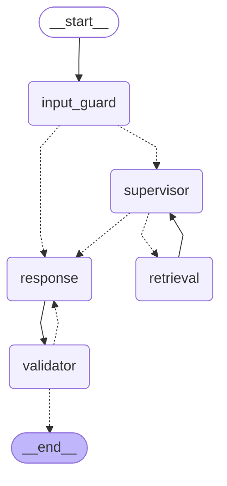

# Agent graph (generated from the code)

Do not edit this file by hand. It is written by `make diagrams` from
[agents/graph.py](../../agents/graph.py), and a test fails when it no longer
matches the code. Dashed arrows are routing decisions; solid arrows always run.

Compare it with the design in [03-agent-graph.drawio.svg](03-agent-graph.drawio.svg).
The research agent, the tool agent, human approval and the memory writer are
added to the code (and appear here) in their own branches.

