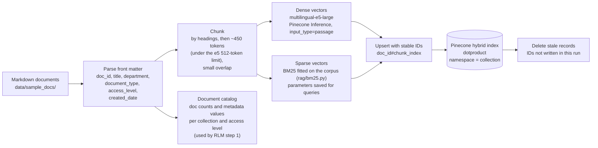
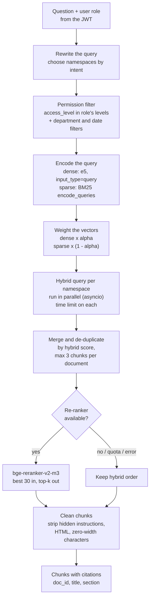

# 4. Search pipeline

How documents get into Pinecone (ingestion), and how a question turns into cited chunks (query). Decisions: [ADR-0003](../adr/0003-pinecone-single-hybrid-index.md), [ADR-0004](../adr/0004-embeddings-and-bm25.md), [ADR-0005](../adr/0005-pinecone-namespaces.md), [ADR-0010](../adr/0010-reranking.md).

## Ingestion

`make ingest` is idempotent:
- Chunk IDs are stable (`<doc_id>#<chunk_index>`), so running it again overwrites the same records instead of adding duplicates.
- Records that no longer match a document (deleted, or now shorter) are removed, so the index always matches the folder.
- The BM25 parameters and the catalog are saved only after Pinecone is up to date.

`make ingest-check` runs the same checks and chunking without calling Pinecone. The code is in [ingestion/](../../ingestion/README.md) and [rag/](../../rag/README.md).



## Query



The query side is built in [rag/retrieval.py](../../rag/retrieval.py) (see [rag/README.md](../../rag/README.md)):

| Step | Status |
|---|---|
| Permission filter, department / type / severity / date / document filters | Built ([rag/filters.py](../../rag/filters.py)) |
| Encode, weight, query namespaces in parallel, merge, re-rank, citations | Built |
| Choose namespaces by intent, rewrite the query, turn "last year" into dates | Built, in the retrieval agent ([agents/nodes/retrieval.py](../../agents/nodes/retrieval.py)). If the model is unavailable, all six namespaces are searched with the question as written |
| Clean chunks | With `feature/guardrails` |

If some namespaces fail or time out, the others still answer and the result lists what was missed. Search fails only when every namespace fails or the question cannot be embedded. Cancelling a search (for example the user closing the page) cancels every running query.

## How the dense and sparse scores are combined

The index uses the `dotproduct` metric and stores a dense vector **and** a sparse vector in each record. At query time both query vectors are scaled before they are sent:

- dense query vector × `alpha`
- sparse query vector × `(1 − alpha)`

Because the dot product is linear, Pinecone then returns:

```text
score = alpha × (dense_q · dense_d) + (1 − alpha) × (sparse_q · sparse_d)
```

That is the weighted combination of the dense score and the BM25 score that the assignment asks for, computed in one query. `alpha` defaults to `0.5` and is tuned with `make eval-retrieval` (hit rate and MRR, see [evals/README.md](../../evals/README.md)). It must be above 0, because Pinecone does not accept an all-zero dense vector; a question with no searchable words sends no sparse part.

## Chunk metadata (used for filters and citations)

| Field | Example | Used for |
|---|---|---|
| `doc_id` | `INC-2026-014` | citations, de-duplication, stable chunk IDs |
| `title` | `Card authorisation timeouts` | citations |
| `section` | `Root cause`, `Discussion > Card payments` | citations point to a real section |
| `department` | `payments` | filters |
| `document_type` | `incident` | filters (RLM step 4) |
| `access_level` | `public` · `internal` · `confidential` · `restricted` | permission filter from the user's role |
| `created_date` | `2026-03-02` (also stored as an integer `created_ts` for range filters) | date filters |
| `source_path` | `data/sample_docs/incidents/INC-2026-014.md` | link from the UI |
| `chunk_index` | `3` | ordering, stable IDs |
| `text` | chunk text | prompt context and quote check |
| `severity` | `SEV1` (incidents only) | filters |
| `tags` | `["payhub", "connection-pool"]` (optional) | filters |
