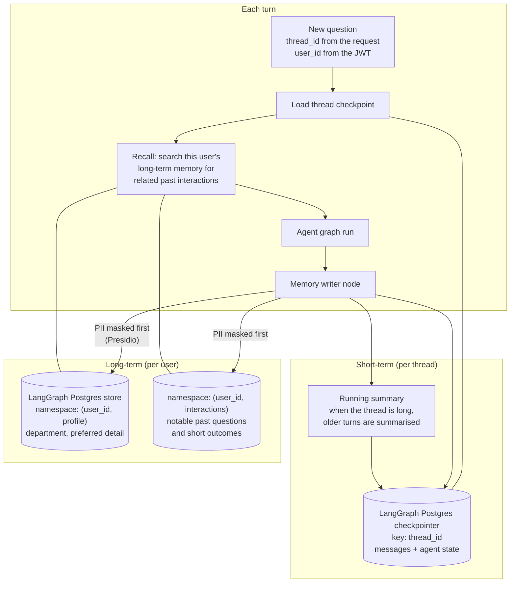

# 8. Memory

Short-term memory per conversation thread, a running summary for long threads, and long-term memory per user. Design reasons: [ADR-0008](../adr/0008-memory-design.md).

## Rules

| Rule | Why |
|---|---|
| `user_id` always comes from the token, never from the request body | One user can't read another user's threads or memory |
| A thread belongs to the user who created it; other users get 404 | Thread isolation |
| PII is masked before anything is saved to long-term memory | Data protection; memory must be safe to show back to the user |
| Only short facts are saved (preferences, department, a one-line summary of notable questions), not whole answers | Small prompts, less sensitive data stored |
| Older turns of a long thread are replaced by a summary in the prompt (the full history stays in the checkpoint) | Keeps prompts within free-tier token limits |
| Each memory update is streamed to the activity panel as a `memory` event | The assignment asks for memory updates to be visible |
| Retention: threads and long-term items older than a configurable number of days (default 30) are deleted by an admin task | Data minimisation; documented in [ASSUMPTIONS.md](../ASSUMPTIONS.md) |
