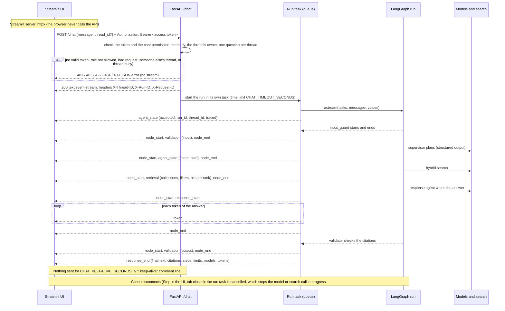

# 9. Streaming to the agent activity panel

`POST /chat` returns a stream of server-sent events (SSE). The Streamlit UI shows the answer's `token` events in the chat window and every other event in the agent activity panel. Why SSE was chosen is in [ADR-0013](../adr/0013-streaming-with-server-sent-events.md); how the UI reads it is in [ADR-0014](../adr/0014-streamlit-chat-ui.md).

The code: [api/routes/chat.py](../../api/routes/chat.py) (the endpoint), [api/sse.py](../../api/sse.py) (the stream), [agents/streaming.py](../../agents/streaming.py) (graph steps to events) and [agents/events.py](../../agents/events.py) (the event types). On the client side: [ui/client.py](../../ui/client.py) (reads the stream), [ui/conversation.py](../../ui/conversation.py) (applies the rules below) and [ui/views.py](../../ui/views.py) (draws the panel).



## The events

Every event's `data` is one line of JSON with `seq` (1, 2, 3, ... within the stream), `request_id` and `type`, plus the fields below. The SSE `id:` line repeats `seq`, and the `event:` line repeats `type`.

| Event | Main fields | Shown in the panel as |
|---|---|---|
| `agent_state` | `status` (`accepted`, then `planned`), `run_id`, `thread_id`, `traced`, `intent`, `plan`, `agents` | "Supervisor: intent = document question, plan = 2 steps" |
| `node_start` / `node_end` | `node`; at the end also `duration_ms`, `status` (`ok` / `error`), `summary` | "retrieval: 6.7 s, ok. Searched runbooks for ..." |
| `retrieval` | `query`, `collections`, `filters`, `failed_collections`, `candidates`, `hits`, `rerank`, `alpha`, `took_ms`, `relaxed` | "runbooks, architecture: 40 matches, 8 after re-ranking" |
| `validation` | `stage` (`input` / `output`), `passed`, `issues`, `attempt` | "Input checks passed", "Citation check passed" |
| `degraded` | `dependency` (`documents` / `language_model`), `message` | "The main model did not answer, so openrouter / ... was used" |
| `response_start` | `attempt`, `reason` (`first` / `rewrite` / `model_switch`) | Clears the answer shown so far |
| `token` | `text` | The answer, word by word |
| `response_end` | `kind`, `text`, `markdown`, `citations`, `steps`, `limits`, `written_by`, `llm_calls`, `duration_ms` | The final answer with its sources |
| `error` | `code` (`timeout`, `internal_error`), `message` | A clear message; the details are in the log under the same `request_id` |

Added by later branches, in the same format:

| Event | Fields | When |
|---|---|---|
| `research` | `plan_source`, `plan_code`, `batches` (label, depth, hits, findings, error, split), `max_depth`, `sources`, `tokens_used`, `stopped_by_budget` | The research agent finished (`feature/rlm-research`) |
| `tool_call` | `tool`, `arguments`, `ok`, `items`, `error`, `duration_ms` | One enterprise data tool call (`feature/mcp-server`) |
| `memory` | `saved` | What the memory writer remembered or summarised (`feature/memory`) |
| `approval_required` | `approval_id`, `action`, `message` | The run stopped to ask the user; the last event of the stream. Answer with `POST /approvals/{approval_id}`, which streams the rest (`feature/hitl-feedback`) |

A stream now ends with `response_end`, `error` or `approval_required`.

## Rules for the client

1. **Tokens are a preview; `response_end` is the answer.** Show tokens as they come, then replace them with `response_end.text` (or `markdown`). The validator may have rejected the draft, and fixed answers (refusals, "documents unavailable", "not found") arrive only in `response_end`, with no tokens.
2. **`response_start` means "start the answer again".** It comes at the start of each attempt (`first`, `rewrite` after the validator rejected a draft) and when one model failed half-way through and the next took over (`model_switch`). Clear the tokens shown so far.
3. **The stream ends with `response_end` or `error`.** Anything else means the connection dropped.
4. **Lines that start with `:` are keep-alives.** Ignore them.
5. **Ask a follow-up by sending back `X-Thread-ID`** as `thread_id`. The conversation continues; one question at a time per thread.

The response agent's tokens are held back while the reply could still be the model's `NOT_FOUND` signal, so the user never sees that word flash up before the friendly "I couldn't find this" message.

The UI follows these rules in `Turn.apply()` ([ui/conversation.py](../../ui/conversation.py)), and keeps event types it does not know yet in an "Other events" list instead of failing. Its tests replay streams recorded from the real API, so a change here that the UI does not handle fails its tests.

## What the stream never contains

- The text of retrieved chunks. The panel gets counts, collections and filters. Sources appear only as citations of the final answer.
- Prompts, the system prompt or the supervisor's raw output.
- Stack traces or exception messages. An `error` event has a fixed, safe message; the details are logged with the same `request_id`.

## How it works inside

- **Where events come from.** The graph runs with three LangGraph stream modes at once: `tasks` (each node starting and finishing, with its state update), `messages` (the language model's tokens, labelled with the node that asked for them) and `values` (the full state, for the final answer). `RunRecorder` turns these into the events above. Only the response agent's tokens are passed on; the supervisor's and the search planner's output is structured data, not text for the user.
- **Its own task.** The run works in a separate asyncio task and puts events on a queue. The response reads the queue and sends a keep-alive when it is quiet. This keeps the time limit, the keep-alive and cancellation separate and simple.
- **Disconnects.** Uvicorn tells Starlette when the client leaves, Starlette stops the response, and the response cancels the run task. Cancellation travels into the model or search call in progress; the model gateway does not treat it as a failure, so no backup model is called for an answer nobody will read. The run shows as cancelled in LangSmith.
- **One ID everywhere.** `run_id` is chosen by the API, sent in the `X-Run-ID` header and the first event, used as the LangGraph run ID and therefore as the LangSmith trace ID. Thumbs-up/down feedback (`feature/hitl-feedback`) will attach to it.

## Metrics

| Metric | What it shows |
|---|---|
| `chat_streams_total{outcome}` | How streams end: `completed`, `cancelled` (client left), `timeout`, `error` |
| `chat_streams_active` | Streams open right now |
| `chat_stream_events_total{type}` | Events sent, by type |
| `chat_first_token_seconds` | How long the user waits for the first word of the answer |

The agent metrics (`agent_node_duration_seconds`, `llm_calls_total`, ...) and the search metrics now appear on the same `/metrics` endpoint as the request metrics.

## Try it

```bash
make run-api                       # in one terminal
make run-ui                        # in another; open http://localhost:8501
make stream Q="The PayHub database connection pool is exhausted. What should I do?" ROLE=analyst
```

`make stream` prints the raw events, which is the quickest way to see exactly what the panel receives.
