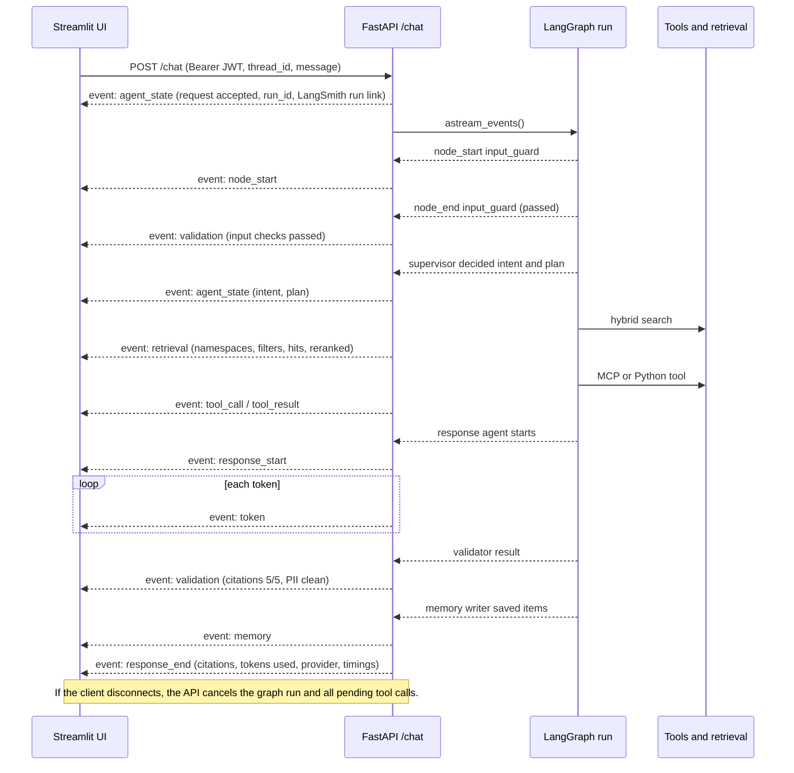

# 9. Streaming to the agent activity panel

`POST /chat` returns a server-sent event (SSE) stream. The Streamlit UI shows `token` events in the chat window and every other event in the agent activity panel.

## Event types

| Event | Payload (main fields) | Shown in the panel as |
|---|---|---|
| `agent_state` | `run_id`, `intent`, `plan`, `trace_url` | "Supervisor: intent = incident analysis, plan = 3 steps" |
| `node_start` / `node_end` | `node`, `started_at`, `duration_ms`, `status` | `research.batch_analyse` started, 1.8 s |
| `tool_call` / `tool_result` | `tool`, `args` (redacted), `status`, `rows`, `duration_ms` | `mcp.incident_records(service="payments")` → 14 rows |
| `retrieval` | `namespaces`, `filters`, `hits`, `reranked`, `alpha` | `incidents`, 32 hits → 8 after re-ranking |
| `memory` | `kind` (`summary`, `profile`, `interaction`), `text` | "Saved preference: department = payments" |
| `validation` | `stage` (`input`, `output`), `checks`, `passed`, `blocked_reason` | guardrails passed, citation check 5/5 |
| `response_start` / `token` / `response_end` | `text`, `citations`, `tokens`, `provider`, `model` | streamed answer, tokens used, LLM provider |
| `degraded` | `dependency`, `behaviour` | "Documents unavailable: answering from MCP data" |
| `error` | `code`, `message`, `request_id` | clear error message, no stack trace |

Every event carries `request_id` and `seq` (an increasing number), so the UI can show events in order and tests can check the order.
