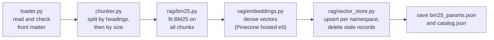

# ingestion

Loads the sample documents in `data/sample_docs/` into the Pinecone hybrid index. It is an offline job, run from your machine with `make ingest`. The API and the other services never import it (an import-linter contract checks this).

## How to run it

```bash
make ingest-check   # read, check and chunk the documents; no key needed, nothing sent
make ingest         # the same, then load everything into Pinecone
```

`make ingest` needs `PINECONE_API_KEY` in `.env`. The other Pinecone settings have working defaults (see `.env.example`). Options:

```bash
uv run python -m ingestion --help
uv run python -m ingestion --docs-dir path/to/docs --out-dir path/to/output
```

Exit codes: `0` done, `1` bad documents or a Pinecone error, `2` missing settings.

## What it does



1. **Load** ([loader.py](loader.py)). Every file must have valid front matter: a known department, document type and access level, a date, and an ID that matches the file name and folder. Problems are collected and reported together. YAML is read with `safe_load`, so a document cannot run code, and symbolic links that point outside the folder are refused.
2. **Chunk** ([chunker.py](chunker.py)):
   - Split at the Markdown headings, so every chunk belongs to one section, such as "Root cause" or "Discussion > Card payments". Citations then point to a real part of the document.
   - Pack a long section's paragraphs into chunks of up to about 450 tokens, with a small overlap. A table is split between rows, and prose between sentences.
3. **Fit BM25** on all chunks, so keyword weights reflect the bank's own vocabulary (system names, incident IDs).
4. **Embed**. Each chunk is sent with its title and section in front of it, for context, to Pinecone's hosted `multilingual-e5-large` model as a "passage". Requests are batched (96 per call), and the Pinecone client retries rate limits and server errors itself.
5. **Upsert** into one namespace per collection. Each record has:
   - a dense vector;
   - a BM25 sparse vector;
   - the chunk metadata, used for filters and citations (see [rag/schema.py](../rag/schema.py)).
6. **Clean up**. Any record in a namespace that this run did not write belongs to a deleted or shortened document, and is removed.
7. **Save** to `data/index/`, which git ignores:
   - `bm25_params.json`, the fitted BM25 statistics. Retrieval loads the same file to encode questions.
   - `catalog.json`, the counts, departments and date ranges per collection and access level. The research agent uses it to explore the collections.

   Both files are written atomically (temporary file, then rename) and only after Pinecone is up to date. If a run fails half-way, the previous files stay in place.

## Running it again is safe

- Record IDs are `<doc_id>#<chunk_index>`. A second run overwrites the same records; it never adds copies.
- The clean-up step means the index always matches the folder exactly.
- The saved files contain no timestamps. With unchanged documents they come out byte-for-byte the same, and `catalog.json` has a `corpus_fingerprint` that changes only when the content does.

When the documents change, the BM25 statistics change too, so every record is re-encoded. With about 560 chunks this is a few embedding calls and well within the free plan.

## Files

| File | Purpose |
|---|---|
| [cli.py](cli.py), [`__main__.py`](__main__.py) | Command line: arguments, settings, friendly errors |
| [loader.py](loader.py) | Read and check documents |
| [chunker.py](chunker.py) | Section-aware chunking |
| [catalog.py](catalog.py) | Build the catalog |
| [pipeline.py](pipeline.py) | Put the steps together; idempotent sync with the index |

The shared pieces (the schema, BM25, embeddings and the Pinecone store) live in [rag/](../rag/README.md), because retrieval uses them too.

## Tests

- **Unit:**
  - `tests/unit/test_loader.py`, `test_chunker.py` (including property tests) and `test_bm25.py`;
  - `test_pinecone_wrappers.py`, against in-memory fakes;
  - `test_sample_corpus.py`, which checks the real demo documents.
- **Integration:**
  - `tests/integration/test_ingestion_pipeline.py`: running twice changes nothing, deleted documents are removed, and nothing is saved when Pinecone fails;
  - `test_ingestion_cli.py`.
- **Security:** `tests/security/test_ingestion_safety.py`. It covers YAML code tags, symbolic links outside the folder, a missing access level, catalog counts by role, and the API key never printed.
- **Live** (opt-in, `make test-live`): one real embedding call.
